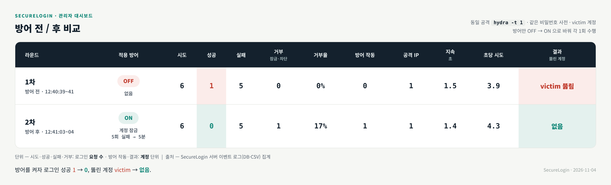
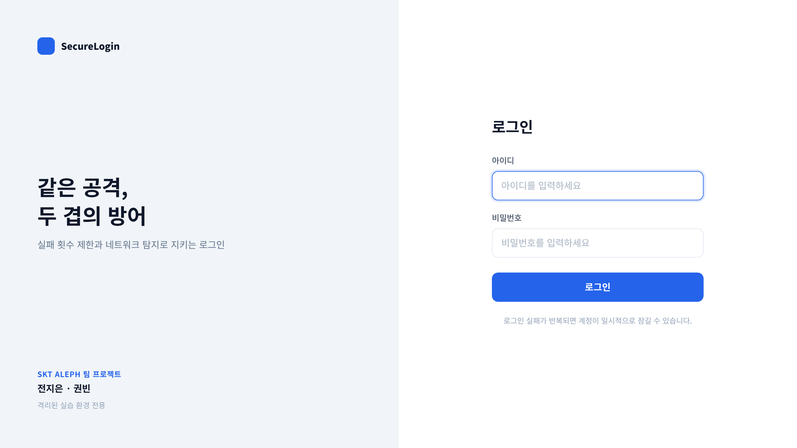
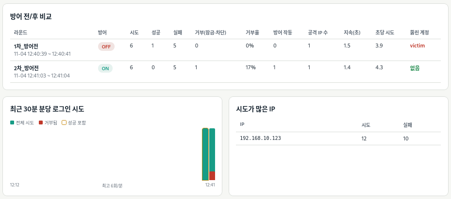
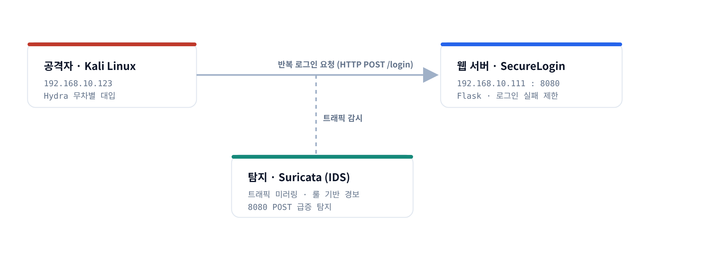
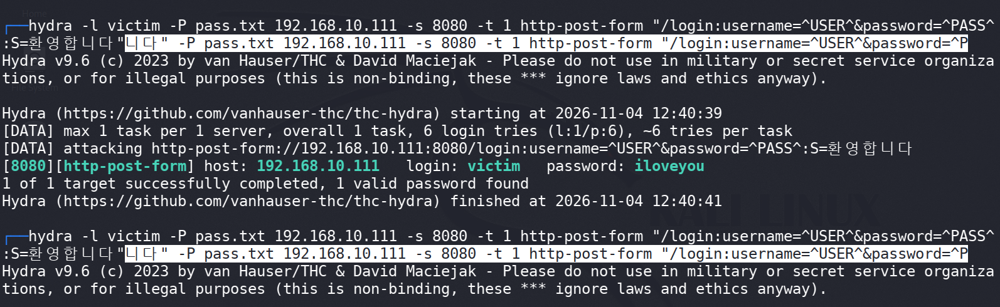
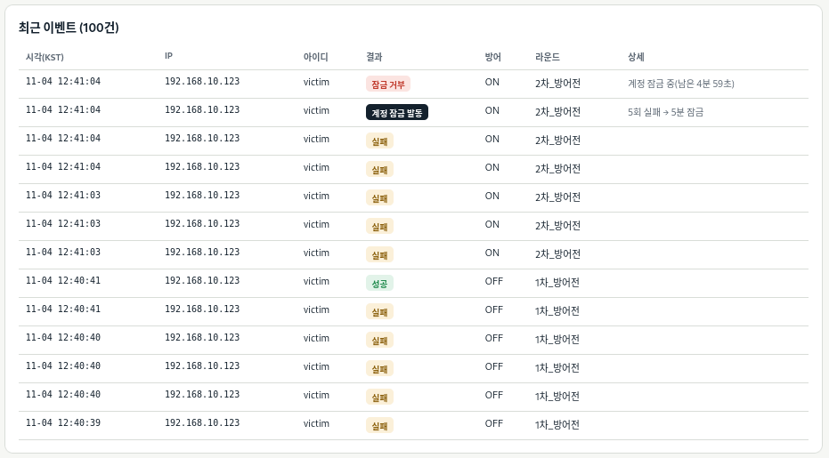

# SecureLogin — 웹·네트워크 2중 방어 로그인 시스템

> 반복 로그인(무차별 대입) 공격을 **웹(차단)** 과 **네트워크(탐지)** 두 층에서 함께 막고, 같은 조건에서 **방어 전/후를 비교**해 효과를 데이터로 증명한 모의해킹 팀 프로젝트입니다.


SKT ALEPH 과정(코리아IT아카데미) 팀 프로젝트 · 2026.10 ~ 2026.11

---

## 한눈에 보기

로그인 실패 횟수 제한이 없으면 공격자는 비밀번호를 무한히 추측할 수 있어 **무차별 대입(Brute Force)** 공격에 그대로 노출됩니다. 이 프로젝트는 직접 만든 로그인 사이트에 그 공격을 재현하고, **로그인 실패 제한(계정 잠금·IP 차단)** 으로 막은 뒤, 같은 공격을 방어 ON/OFF로 각각 돌려 결과를 비교합니다.

| | 방어 OFF | 방어 ON |
|---|---|---|
| 적용 방어 | 없음 | 계정 잠금 (5회 실패 → 5분) |
| 로그인 성공 | **1** | **0** |
| 뚫린 계정 | 🔴 `victim` 탈취 | 🟢 없음 |

> 같은 공격·같은 사전·같은 옵션(`hydra -t 1`)에서, 방어를 켜자 성공이 **1 → 0**, 뚫린 계정이 **victim → 없음** 으로 바뀌었습니다.



---

## 담당 역할

본 저장소의 **웹 층**은 제가 설계·구현했습니다. (2인 팀 프로젝트)

| 구분 | 담당 | 내용 |
|---|---|---|
| **웹 층** | **권빈 (본인)** | 로그인 사이트, 로그인 실패 제한, 이벤트 기록, 관리자 대시보드 |
| 네트워크 층 | 전지은 | Kali·Hydra 공격, Suricata 탐지 룰, 망 구성 |

---

## 주요 기능 (웹 층)

- **로그인 사이트** — Flask + SQLite. 비밀번호는 해시(werkzeug)로만 저장하고, 존재하지 않는 아이디도 더미 해시로 비교해 **아이디 존재 여부·응답 시간 차이**가 드러나지 않게 처리.
- **로그인 실패 제한**
  - 계정: 10분 내 **5회 실패 → 5분 잠금**
  - IP: 10분 내 **20회 실패 → 10분 차단**
  - 잠금 중에는 **올바른 비밀번호도 거부**
- **이벤트 기록** — 모든 로그인 시도를 DB·텍스트 로그(KST)에 기록, CSV 내보내기.
- **관리자 대시보드** — 방어 ON/OFF 전환, **라운드별 방어 전/후 자동 비교표**, 분당 시도 그래프, 상위 IP, 최근 이벤트 100건, 잠금 해제·기록 초기화.

| 로그인 화면 | 관리자 대시보드 |
|---|---|
|  |  |

---

## 시스템 구조



공격자(Kali)가 웹 서버로 반복 로그인을 보내고, 그 트래픽을 Suricata가 탐지합니다. 네트워크에서 **알아채고(탐지)**, 웹에서 **끊는(차단)** 심층 방어(Defense in Depth) 구조입니다.

---

## 실행 방법

> 격리된 실습 VM(리눅스)에서만 사용하세요.

```bash
# 1) 설치
python3 -m venv venv
source venv/bin/activate
pip install -r requirements.txt

# 2) DB·계정 생성 (처음 한 번) — 관리자 비밀번호 설정, 시연용 victim 계정 자동 생성
python3 app.py init

# 3) 서버 실행
python3 app.py run        # http://0.0.0.0:8080/login  (관리자: /admin)
```

- 리눅스에서 한 번에 설치·실행: `bash start.sh`
- 계정 추가: `python3 app.py adduser <아이디> [admin|user]`

### 방어 전/후 비교 시연 순서

1. 관리자 대시보드에서 **기록 초기화**
2. 방어 **OFF**, 라운드 `1차-방어전` → 공격 1회
3. 방어 **ON**, 라운드 `2차-방어후` → 같은 공격 1회
4. 대시보드 비교표 + CSV로 결과 확보

---

## 무차별 대입 공격 재현 (팀원 담당)

```bash
hydra -l victim -P pass.txt 192.168.10.111 -s 8080 -t 1 \
  http-post-form "/login:username=^USER^&password=^PASS^:S=환영합니다"
```

| 공격 터미널 (방어 OFF) | 계정 잠금 (방어 ON) |
|---|---|
|  |  |

**방어 ON에서 왜 6번째 시도가 있었나?** Hydra는 계정 잠금을 모르고 사전 6개를 모두 전송합니다. 서버는 5번째 실패에서 계정을 잠그고, 6번째 요청(정답 `iloveyou`)을 잠금 상태라 거부했습니다. 방어 OFF에서 성공했던 바로 그 요청이 ON에서는 막혀 **성공 1 → 0** 이 됩니다.

---

## 기술 스택

| 영역 | 기술 |
|---|---|
| 웹 | Python · Flask · SQLite · werkzeug(해시) · Jinja2 |
| 공격 | Kali Linux · Hydra |
| 탐지 | Suricata (IDS) |
| 환경 | VMware (격리 VM) |

---

## 보안 설계 포인트

- **비밀번호 해시 저장** — 평문 저장 시 DB 유출로 전 계정이 노출되는 위험(OWASP A02)에 대비.
- **아이디 노출 방지** — 없는 아이디도 더미 해시와 비교해 성공/실패 응답을 동일하게 유지.
- **실패 제한 (OWASP A07)** — 무제한 로그인 시도를 계정 잠금·IP 차단으로 차단.
- **로깅·경고 (OWASP A09)** — 모든 시도를 기록하고 Suricata로 네트워크 단에서 탐지.

---

## 프로젝트 구조

```
.
├── app.py              # 웹 서버 (로그인·실패 제한·이벤트 기록·대시보드)
├── templates/          # 로그인·환영·관리자 대시보드 화면
├── requirements.txt
├── start.sh            # 한 번에 설치·실행 스크립트
└── docs/images/        # 스크린샷
```
